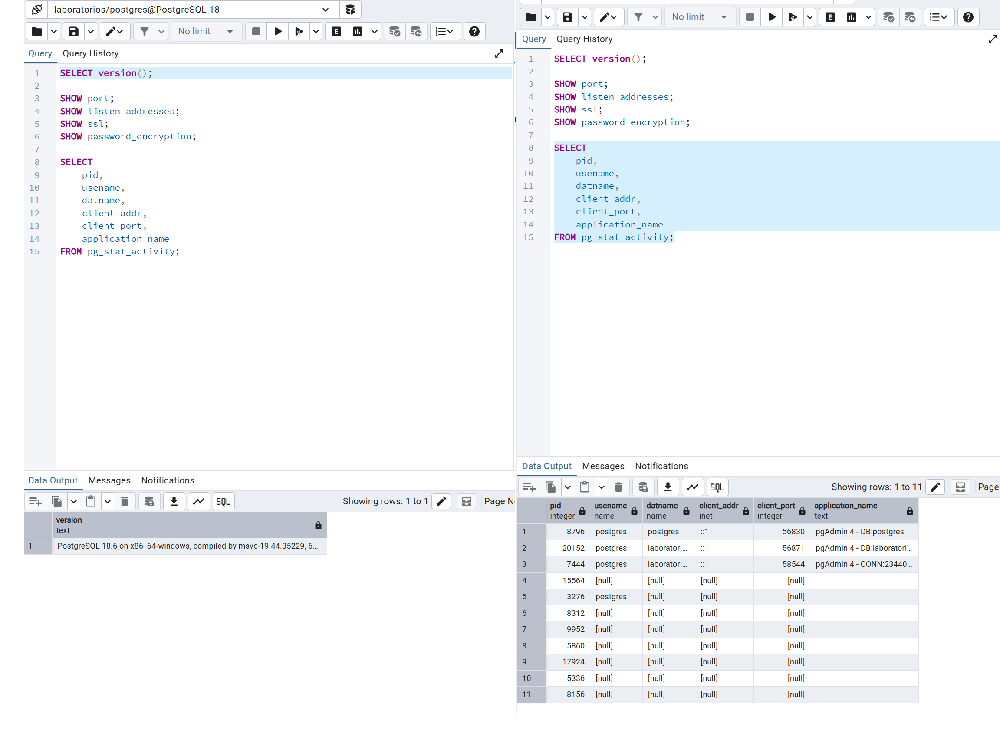
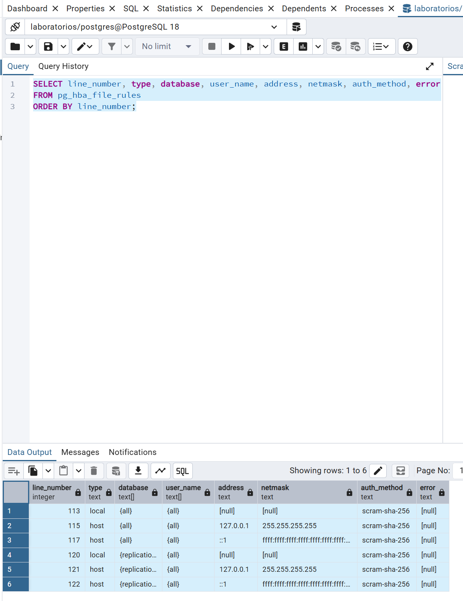
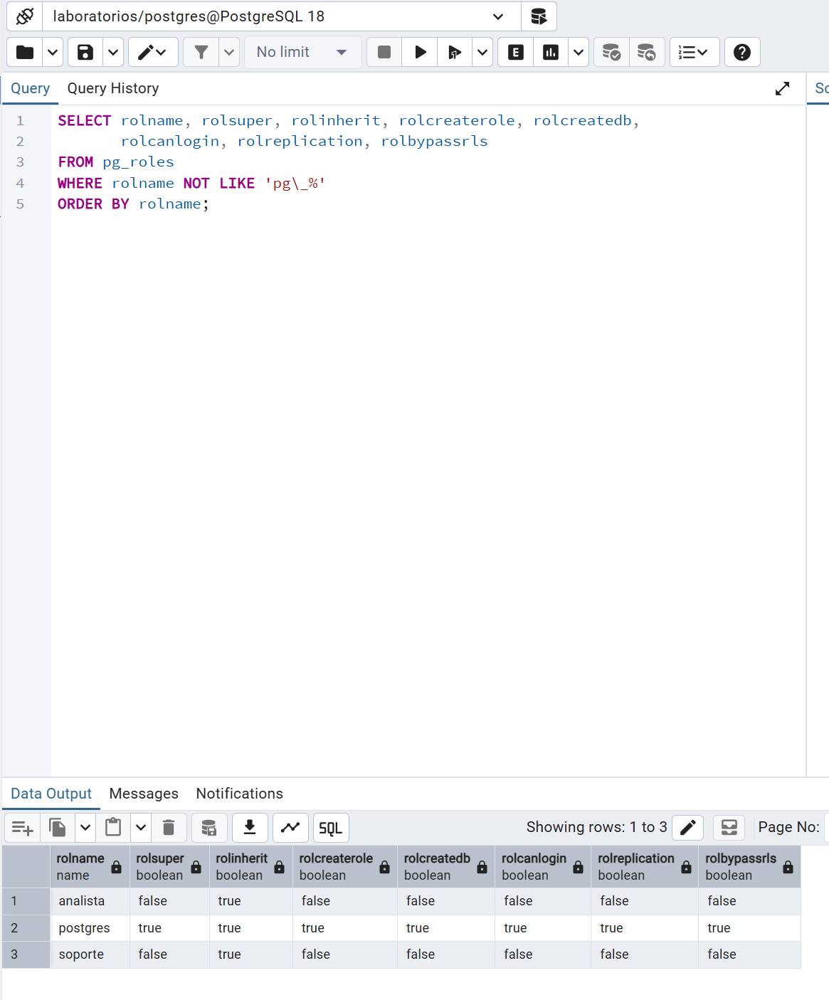
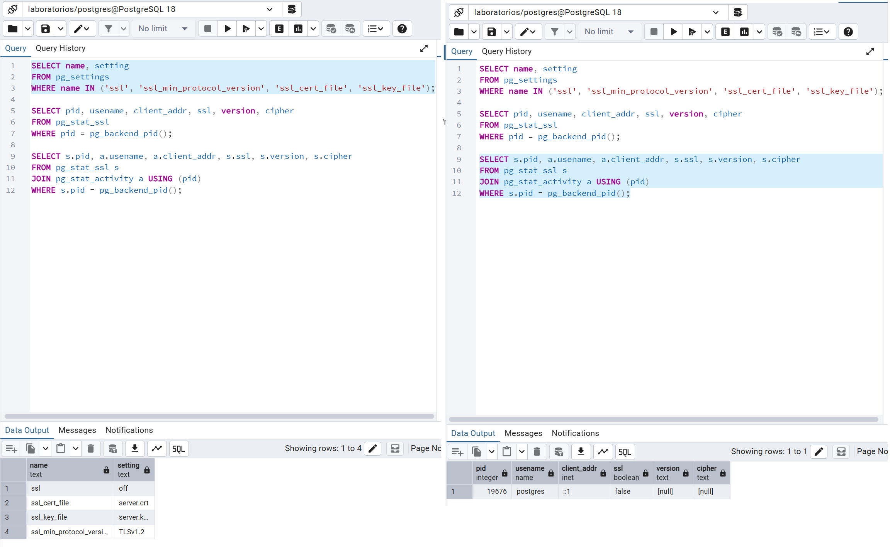

# Informe: LAB-04 Hardening y configuración segura de PostgreSQL

## Actividad 1: Identificar la superficie de ataque

**Entorno:** PostgreSQL 18.6 sobre Windows x86_64, administrado con pgAdmin 4.

| Elemento | Estado actual | ¿Es necesario? | Riesgo |
|---|---|---|---|
| Puerto PostgreSQL | 5432 (por defecto) | Sí, pero restringido | Bajo/Medio |
| Interfaces de escucha | `*` (todas) | No, solo se usa localhost | Alto |
| Conexiones remotas | Ninguna activa (solo `::1`) | No | Medio |
| Usuarios administrativos | `postgres` usado como cuenta de trabajo | No debería | Alto |
| SSL/TLS | `off` | Sí | Medio/Alto |
| Métodos de autenticación | `scram-sha-256` | Sí | Bajo |



**¿Por qué conocer la superficie de ataque debe preceder al hardening?**

Porque no se puede proteger lo que no se conoce. Antes de cerrar o restringir
algo, hay que saber qué está expuesto (puerto, interfaces de escucha, reglas de
acceso, cuentas con privilegios) y cuáles de esos puntos se usan realmente. Así
se evita bloquear servicios legítimos y se priorizan los cambios según el riesgo
real. En este laboratorio, el inventario inicial mostró que el servidor escucha
en todas las interfaces (`listen_addresses = '*'`), no usa TLS (`ssl = off`) y
que todos los clientes se conectan desde `::1` (localhost), lo que demostró que
la exposición en red era innecesaria.

## Actividad 2: Identificar los archivos de configuración

| Parámetro | Ruta / valor | Categoría |
|---|---|---|
| `data_directory` | `C:/Program Files/PostgreSQL/18/data` | Datos |
| `config_file` | `C:/Program Files/PostgreSQL/18/data/postgresql.conf` | Configuración |
| `hba_file` | `C:/Program Files/PostgreSQL/18/data/pg_hba.conf` | Autenticación |
| `ident_file` | `C:/Program Files/PostgreSQL/18/data/pg_ident.conf` | Autenticación (mapeo de usuarios) |
| `log_directory` | `log` (relativa al directorio de datos: `C:/Program Files/PostgreSQL/18/data/log`) | Logs |
| `log_connections` | vacío (equivale a desactivado en PostgreSQL 18) | Logs |
| `log_disconnections` | `off` | Logs |

**Observación:** los cuatro tipos de archivo están dentro del mismo directorio de datos. Quien obtenga acceso de lectura a esa carpeta podría ver la configuración, las reglas de autenticación y los datos. Además, el servidor no registra conexiones ni desconexiones, así que no habría rastro de quién se conectó.

**¿Por qué es importante conocer la ubicación física de estos archivos?**

Porque la seguridad de PostgreSQL no depende solo de la base de datos, sino también del sistema operativo. `pg_hba.conf` define quién puede conectarse, `postgresql.conf` define cómo se comporta el servidor y el directorio de datos contiene la información real. Si no se sabe dónde están, no se pueden revisar sus permisos, respaldar antes de modificar, ni vigilar cambios no autorizados. Además, distinguir datos, configuración, autenticación y logs permite aplicar controles distintos a cada uno (por ejemplo, proteger la configuración contra escritura y los logs contra borrado).

## Actividad 3: Revisar `listen_addresses`

**Configuración encontrada:** `listen_addresses = '*'`. PostgreSQL escucha en **todas las interfaces**.

**Verificación con `netstat -ano | findstr 5432`:**

| Dirección local | Estado | Significado |
|---|---|---|
| `0.0.0.0:5432` | LISTENING | Escucha en todas las interfaces IPv4 |
| `[::]:5432` | LISTENING | Escucha en todas las interfaces IPv6 |
| `[::1]:5432` ↔ `[::1]:56830`, `56871`, `58544` | ESTABLISHED | Conexiones activas, todas locales (pgAdmin) |

**Interfaces necesarias:** `127.0.0.1` y `::1` (localhost), porque todos los clientes observados (pgAdmin) se conectan desde la propia máquina.

**Interfaces innecesarias:** cualquier otra interfaz de red (Wi-Fi, Ethernet, adaptadores virtuales), ya que ningún cliente remoto las usa.

### Análisis de arquitecturas

**Arquitectura 1:** Internet → Firewall → Servidor PostgreSQL (puerto 5432 alcanzable).
**Arquitectura 2:** Internet ✗ → Firewall → Red privada → Servidor PostgreSQL.

La **arquitectura 2** reduce mejor la exposición, porque:

1. El servidor no es alcanzable directamente desde Internet, así que no puede ser escaneado ni atacado por fuerza bruta desde fuera.
2. Hay varias capas (firewall y red privada), de modo que si una falla, las otras siguen protegiendo (defensa en profundidad).
3. Solo los equipos de la red privada pueden intentar conectarse, lo que reduce el número de posibles atacantes.
4. En la arquitectura 1, la seguridad depende únicamente de contraseñas y reglas de `pg_hba.conf`, mientras que en la 2 además se limita quién puede llegar al puerto.

## Actividad 4: Revisar `pg_hba.conf`

Consulta ejecutada sobre `pg_hba_file_rules`:

| Línea | Tipo | Base de datos | Usuario | Dirección | Máscara | Método | Clasificación |
|---|---|---|---|---|---|---|---|
| 113 | local | all | all | n/a | n/a | scram-sha-256 | Regla local (socket) |
| 115 | host | all | all | 127.0.0.1 | 255.255.255.255 (/32) | scram-sha-256 | IPv4, solo localhost |
| 117 | host | all | all | ::1 | ffff:...:ffff (/128) | scram-sha-256 | IPv6, solo localhost |
| 120 | local | replication | all | n/a | n/a | scram-sha-256 | Replicación local |
| 121 | host | replication | all | 127.0.0.1 | 255.255.255.255 (/32) | scram-sha-256 | Replicación IPv4 local |
| 122 | host | replication | all | ::1 | ffff:...:ffff (/128) | scram-sha-256 | Replicación IPv6 local |



**Hallazgos:**

- **Reglas locales:** 2 (líneas 113 y 120).
- **Reglas IPv4:** 2 (líneas 115 y 121), ambas `127.0.0.1/32`.
- **Reglas IPv6:** 2 (líneas 117 y 122), ambas `::1/128`.
- **Bases de datos afectadas:** `all` y `replication`.
- **Usuarios afectados:** `all`.
- **Redes permitidas:** solo localhost.
- **Método de autenticación:** `scram-sha-256` en todas las reglas.
- **Reglas excesivamente amplias (`0.0.0.0/0` o `::/0`):** ninguna.
- **Campo `error`:** sin errores de sintaxis.

**Conclusión:** el archivo ya limita el origen a localhost y usa un método moderno. Los puntos de mejora son que todas las reglas usan `all` en usuario y base de datos, y que las reglas de `replication` no parecen necesarias. Aunque `pg_hba.conf` rechazaría conexiones remotas, el servidor sigue escuchando en todas las interfaces, por lo que la protección depende de una sola capa.

## Actividad 5: Analizar una regla permisiva

Regla conceptual analizada:

```
host    all    all    0.0.0.0/0    scram-sha-256
```

| Pregunta | Respuesta |
|---|---|
| ¿Qué bases de datos permite? | Todas (`all`), incluidas `postgres`, `template1` y las de otras aplicaciones. |
| ¿Qué usuarios permite? | Todos (`all`), incluidos los superusuarios. |
| ¿Qué direcciones de origen permite? | Cualquier dirección IPv4 (`0.0.0.0/0`). |
| ¿Qué método usa? | `scram-sha-256`: contraseña con intercambio desafío-respuesta, sin enviarla en claro. |
| ¿Por qué es una exposición innecesaria? | Permite que cualquier equipo de Internet intente autenticarse con cualquier usuario sobre cualquier base. La seguridad queda reducida a la contraseña, y quedan expuestas la fuerza bruta, los usuarios por defecto como `postgres` y las vulnerabilidades del servicio. |
| ¿Qué información se necesita para restringirla? | Qué aplicación o persona se conecta, desde qué IP o red, a qué base de datos y con qué usuario. |

**Documentación previa a cualquier cambio:**

- **Regla actual:** en este laboratorio no existe una regla `0.0.0.0/0`. Las reglas actuales son `host all all 127.0.0.1/32` y `host all all ::1/128`, ambas con `scram-sha-256`.
- **Problema:** aunque el origen está limitado, `all`/`all` permite a cualquier usuario local conectarse a cualquier base. Además, `listen_addresses = '*'` hace que el puerto esté alcanzable desde la red.
- **Origen que realmente necesita acceso:** `127.0.0.1` y `::1` (pgAdmin, en la misma máquina).
- **Base de datos:** `laboratorios` (y `postgres` para administración).
- **Usuario:** hoy `postgres`. Debería ser un usuario de aplicación y otro de administración.
- **Regla propuesta:** ver la Actividad 6.

## Actividad 6: Aplicar mínimo privilegio a conexiones (diseño)

Reglas propuestas para el entorno real (pendiente de aplicar en la fase de cambios, una vez creado el rol de aplicación):

```
host    laboratorios    app_lab      127.0.0.1/32    scram-sha-256
host    laboratorios    app_lab      ::1/128         scram-sha-256
host    postgres        dba_lab      127.0.0.1/32    scram-sha-256
host    postgres        dba_lab      ::1/128         scram-sha-256
```

Cada regla restringe los cuatro elementos: **base de datos + usuario + origen + método de autenticación**. Las reglas de `replication` se eliminarían si no se usa replicación. `app_lab` y `dba_lab` son nombres de ejemplo; los roles se crearán en la fase de cambios.

## Actividad 7: Revisar autenticación

**`password_encryption` = `scram-sha-256`.** Las contraseñas nuevas se almacenan con SCRAM-SHA-256, el mecanismo recomendado, y no con `md5`. No requiere cambios.

**¿Qué diferencia existe entre autenticación y autorización?**
La autenticación verifica **quién eres** (usuario y contraseña, certificado). La autorización define **qué puedes hacer** una vez identificado (`GRANT`, atributos del rol, propiedad de objetos). Una conexión puede autenticarse correctamente y aun así no tener permiso para leer una tabla.

**¿Qué protege `scram-sha-256`?**
Protege la contraseña de dos formas. En el servidor se guarda un verificador derivado (sal, iteraciones y claves), no la contraseña. En la red, el cliente demuestra que la conoce mediante un intercambio desafío-respuesta, sin enviarla. Resiste mejor la captura de tráfico y los ataques de diccionario sobre el hash que `md5`. No cifra el resto del tráfico, para eso se necesita TLS.

**¿Por qué una contraseña almacenada mediante un mecanismo de autenticación no debe confundirse con cifrado reversible?**
Porque el verificador es un hash con derivación de clave y no se puede descifrar para recuperar la contraseña. El servidor solo comprueba que la contraseña presentada produce el mismo resultado. El cifrado reversible permite recuperar el texto original con una clave, lo cual sería una debilidad para almacenar credenciales.

**¿Qué sucede si una cuenta tiene permisos excesivos aunque utilice una contraseña fuerte?**
La contraseña fuerte solo dificulta que alguien se haga pasar por la cuenta. Si la cuenta se compromete por otra vía (inyección SQL en la aplicación, credencial filtrada en el código, equipo comprometido), el atacante hereda todos sus permisos. El daño depende de los privilegios, no de la contraseña.

## Actividad 8: Revisar usuarios y privilegios

Roles encontrados (excluyendo los internos `pg_*`):

| Rol | LOGIN | SUPERUSER | CREATEROLE | CREATEDB | REPLICATION | BYPASSRLS | Función |
|---|---|---|---|---|---|---|---|
| `postgres` | Sí | **Sí** | **Sí** | **Sí** | **Sí** | **Sí** | Administrador del servidor. Se usa también como cuenta de trabajo (pgAdmin). |
| `analista` | No | No | No | No | No | No | Rol de grupo, probablemente para consulta o análisis. |
| `soporte` | No | No | No | No | No | No | Rol de grupo, probablemente para tareas de soporte. |



**Identificación:**

- **Superusuarios:** `postgres`.
- **Usuarios que pueden iniciar sesión:** solo `postgres`.
- **Usuarios con CREATEROLE:** `postgres`.
- **Usuarios con CREATEDB:** `postgres`.
- **Roles utilizados por aplicaciones:** ninguno dedicado. La conexión de pgAdmin usa `postgres`.
- **Cuentas que podrían ser innecesarias:** `analista` y `soporte` no representan riesgo por sí mismos (no pueden iniciar sesión), pero hay que verificar a qué roles pertenecen y qué permisos tienen para confirmar que son necesarios.

**¿Por qué no debería utilizarse una cuenta SUPERUSER como cuenta normal de una aplicación?**
Porque un superusuario ignora todas las comprobaciones de permisos: puede leer y modificar cualquier dato, crear y borrar roles y bases de datos, cargar extensiones, y ejecutar `COPY ... PROGRAM` o leer archivos del servidor, lo que puede llevar a ejecutar comandos en el sistema operativo. Si la aplicación se compromete (por ejemplo, con una inyección SQL), el atacante obtiene control total del servidor y no solo de los datos de la aplicación. Además, un error de la aplicación podría borrar o alterar datos que no le corresponden.

### Complemento de la Actividad 8: membresías y permisos de los roles de grupo

**Membresías:** la consulta sobre `pg_auth_members` devolvió vacío. `analista` y `soporte` no tienen ningún miembro, por lo que actualmente no los usa ninguna cuenta.

**Permisos sobre tablas y vistas (base `laboratorios`):**

| Rol | Esquema | Objeto | Privilegio | Observación |
|---|---|---|---|---|
| `analista` | `analitica` | `clientes` (tabla) | SELECT | Acceso directo a la tabla base. Revisar si contiene datos sensibles. |
| `analista` | `public` | `v_analitica_clientes` (vista) | SELECT | Acceso mediante vista. Correcto. |
| `soporte` | `public` | `v_clientes_soporte` (vista) | SELECT | Acceso mediante vista, solo lectura. Correcto. |

**Conclusión:** los roles de grupo siguen un diseño de mínimo privilegio (solo lectura, y en el caso de `soporte` solo a través de una vista). Sin embargo, no están asignados a ninguna cuenta con `LOGIN`, así que en la práctica todo el trabajo se hace con `postgres`. El acceso directo de `analista` a `analitica.clientes` debe revisarse.


## Actividad 9: Separar cuentas administrativas y de aplicación

| Cuenta | Propósito | LOGIN | Privilegios | Origen permitido |
|---|---|---|---|---|
| `dba_lab` | Administración | Sí | Administrativos (`CREATEROLE`, `CREATEDB`), sin usarse para aplicaciones | `127.0.0.1`, `::1` |
| `app_lab` | Conexión del software | Sí | Mínimos: `CONNECT`, `USAGE` en el esquema y `SELECT/INSERT/UPDATE/DELETE` solo sobre las tablas necesarias | `127.0.0.1`, `::1` |
| `consulta_lab` | Consulta | Sí | Solo lectura (`SELECT`), por ejemplo mediante pertenencia a `analista` | `127.0.0.1`, `::1` |
| `postgres` | Cuenta de emergencia | Sí | Superusuario, reservada para mantenimiento | Solo local |

**¿Qué riesgo existe si la aplicación se conecta utilizando una cuenta administrativa?**
Cualquier vulnerabilidad de la aplicación se convierte en control total del servidor. Un atacante podría leer o borrar todas las bases, crear cuentas persistentes, cambiar contraseñas y, siendo superusuario, alcanzar el sistema operativo. También se pierde la trazabilidad (no se distingue qué hizo la aplicación y qué hizo el administrador) y se incumple el principio de mínimo privilegio.

## Actividad 10: Revisar extensiones

| Extensión | Versión | ¿Necesaria? | Observación |
|---|---|---|---|
| `plpgsql` | 1.0 | Sí | Lenguaje procedural que se instala por defecto. Muchas funciones y herramientas dependen de él. |
| `pgcrypto` | 1.4 | Depende | Instalada para las prácticas de cifrado (LAB-02). Se mantiene si la aplicación usa funciones criptográficas. En otro entorno que no la use, debería eliminarse. |

**Análisis:** que una extensión esté instalada no la hace insegura. El principio de hardening es habilitar únicamente la funcionalidad necesaria para el propósito del sistema. Solo hay dos extensiones, y `pgcrypto` es la única que podría considerarse funcionalidad adicional según el entorno. Se recomienda documentar para qué se usa y, si no se usa, ejecutar `DROP EXTENSION pgcrypto;` tras verificar que ningún objeto depende de ella.

## Actividad 11: Revisar configuración relacionada con conexiones

| Parámetro | Valor actual | Función | Evaluación |
|---|---|---|---|
| `max_connections` | 100 | Número máximo de conexiones simultáneas al servidor. Cada una consume un proceso y memoria. | Es el valor por defecto. Solo se observaron 3 conexiones, así que hay margen. Puede reducirse si el entorno es pequeño. |
| `superuser_reserved_connections` | 3 | Reserva cupos que solo pueden usar superusuarios, para poder entrar a administrar aunque se agoten las conexiones normales. | Adecuado. Los usuarios normales disponen de 97 conexiones. |
| `statement_timeout` | 0 ms (desactivado) | Cancela cualquier sentencia que supere el tiempo indicado. | Sin límite. Una consulta mal hecha o maliciosa puede ejecutarse indefinidamente. |
| `idle_in_transaction_session_timeout` | 0 ms (desactivado) | Cierra la sesión que permanece dentro de una transacción abierta sin actividad durante el tiempo indicado. | Sin límite. Una transacción abandonada puede retener bloqueos indefinidamente. |

**Valores propuestos (a aplicar en la fase de cambios):**

- `idle_in_transaction_session_timeout = '5min'`
- `statement_timeout`: definirlo por rol de aplicación (por ejemplo `ALTER ROLE app_lab SET statement_timeout = '30s';`) y no de forma global, para no interrumpir tareas de mantenimiento largas del administrador.

**¿Por qué mantener conexiones indefinidamente abiertas puede representar un problema de disponibilidad o consumo de recursos?**
Cada conexión es un proceso del servidor que consume memoria y ocupa uno de los cupos de `max_connections`. Si se acumulan conexiones inactivas o abandonadas, se agotan los cupos y los usuarios legítimos ya no pueden conectarse, lo que equivale a una denegación de servicio. Además, una transacción abierta e inactiva puede retener bloqueos que frenan a otras sesiones e impedir que `autovacuum` limpie filas muertas, lo que degrada el rendimiento con el tiempo. Por último, una sesión olvidada y autenticada es una puerta abierta que sigue disponible si alguien accede al equipo cliente.

## Actividad 12: Revisar permisos del sistema operativo

Sistema operativo: Windows. Se utilizó `icacls` en lugar de `ls -l`.

**Cuenta que ejecuta el servicio** (`postgresql-x64-18`): `NT AUTHORITY\NetworkService`.

| Objeto | Propietario / cuentas con acceso | Permisos | ¿Lectura por otros usuarios? |
|---|---|---|---|
| `data` (directorio de datos) | `Administradores`, `SYSTEM`, `NETWORK SERVICE`, `Lenin`, `CREATOR OWNER` | Control total (F) | No. No aparecen `Users` ni `Everyone` |
| `postgresql.conf` | `Administradores`, `SYSTEM`, `NETWORK SERVICE`, `Lenin` | Control total (F), heredado | No |
| `pg_hba.conf` | `Administradores`, `SYSTEM`, `NETWORK SERVICE`, `Lenin` | Control total (F), heredado | No |

**Análisis:**

- **Propietario y grupo:** el servicio se ejecuta con una cuenta sin privilegios de administrador (`NetworkService`), lo cual es correcto: si el servicio se compromete, el atacante no obtiene control total de Windows.
- **Lectura por otros usuarios:** ningún grupo amplio (`Users`, `Everyone`, `Authenticated Users`) tiene acceso al directorio de datos ni a los archivos de configuración.
- **Observación 1:** la cuenta del servicio tiene permiso de escritura sobre `pg_hba.conf` y `postgresql.conf`. Si el servidor se compromete, un atacante podría alterar las reglas de acceso. Una mejora sería dejar esos dos archivos en solo lectura para `NETWORK SERVICE`. Debe probarse con cuidado, porque `ALTER SYSTEM` escribe en `postgresql.auto.conf` y no en `postgresql.conf`.
- **Observación 2:** el usuario personal `Lenin` tiene control total. Es aceptable en un laboratorio, pero en producción solo debería tenerlo un grupo administrativo.
- **Conclusión:** los permisos del sistema operativo son adecuados y no se requieren cambios obligatorios.

**¿Por qué no es suficiente proteger PostgreSQL mediante `GRANT` y `REVOKE` si cualquier usuario del sistema operativo puede leer archivos sensibles?**

Porque `GRANT` y `REVOKE` solo controlan el acceso **a través del servidor PostgreSQL**. Quien lee los archivos directamente desde el sistema operativo se salta todos esos controles. Con acceso al directorio de datos podría copiar los archivos de las bases y abrirlos en otro servidor, o leer `pg_hba.conf` para conocer las reglas de acceso. Con acceso de escritura, podría modificar la configuración para abrir el acceso. La seguridad de la base de datos es tan fuerte como la del sistema operativo que la aloja.

## Actividad 13: Revisar exposición de red

**Dirección de escucha:** `0.0.0.0` (IPv4) y `[::]` (IPv6).

**Puerto:** `5432`.

**¿Está expuesto fuera de la interfaz necesaria?** **Sí.** El servicio solo necesita localhost, pero escucha en todas las interfaces. Que no haya conexiones externas activas no significa que no se puedan establecer: lo único que lo impide en este momento son las reglas de `pg_hba.conf` y del firewall, que aún no se han revisado.

## Actividad 14: Diseñar una política de firewall

**Estado actual (Windows Defender Firewall):**

| Elemento | Resultado |
|---|---|
| Perfiles del firewall | Dominio, Privado y Público: **activados** |
| Regla de entrada para PostgreSQL (por nombre) | No se encontró ninguna |
| Regla de entrada para el puerto 5432 | Verificado con `Get-NetFirewallPortFilter` (No se encontró ninguna) |

**Observación:** el firewall está activo y no existe una regla explícita que permita conexiones entrantes al puerto 5432, por lo que, con la configuración actual, un equipo remoto probablemente no podría llegar al servicio. Esto reduce el riesgo de `listen_addresses = '*'`, pero esa protección depende de una sola regla del sistema operativo. Si alguien crea una regla permisiva (o un instalador la agrega), el servidor quedaría expuesto.

**Política conceptual** (PostgreSQL en 10.10.10.20, puerto 5432, acceso solo para la red DBA 10.10.10.0/24):

| Origen | Destino | Puerto | Acción |
|---|---|---|---|
| 10.10.10.0/24 | PostgreSQL (10.10.10.20) | 5432 | Permitir |
| Cualquier otro origen | PostgreSQL (10.10.10.20) | 5432 | Denegar |

**¿Por qué `pg_hba.conf` y el firewall no son controles equivalentes?**

Actúan en capas distintas. El firewall trabaja en la red: decide si un paquete **llega** al puerto, sin saber nada de PostgreSQL. `pg_hba.conf` trabaja dentro del servidor: decide si una conexión que **ya llegó** puede autenticarse, según base de datos, usuario, origen y método. Si solo existe `pg_hba.conf`, el puerto sigue visible para escaneos, fuerza bruta contra el servicio y vulnerabilidades del propio servidor. Si solo existe el firewall, cualquier equipo de la red permitida puede intentar entrar con cualquier usuario y base. Se complementan (defensa en profundidad).

## Actividad 15: Revisar TLS

| Parámetro | Valor | Evaluación |
|---|---|---|
| `ssl` | `off` | TLS desactivado. El tráfico viaja sin cifrar. |
| `ssl_min_protocol_version` | `TLSv1.2` | Correcto, pero sin efecto mientras `ssl` esté apagado. |
| `ssl_cert_file` | `server.crt` | Ruta por defecto (relativa al directorio de datos). Pendiente de verificar que el archivo exista. |
| `ssl_key_file` | `server.key` | Ruta por defecto (relativa al directorio de datos). Pendiente de verificar que el archivo exista. |

Consulta de la conexión actual (corregida: se une `pg_stat_ssl` con `pg_stat_activity` por `pid`, porque `usename` y `client_addr` no son columnas de `pg_stat_ssl`):



**¿La conexión actual utiliza TLS?** No. `ssl = f`.

**Versión:** vacía (no aplica).

**Cipher:** vacío (no aplica).

**Relación con LAB-02:** en LAB-02 se vio cómo funciona el cifrado y TLS. En este laboratorio no basta con saber que TLS existe: hay que verificar que esté **integrado en la configuración**. Aquí no lo está: el servidor tiene la versión mínima configurada, pero TLS está apagado, y es probable que no existan certificado ni clave. Aunque hoy todo el tráfico es local (`::1`), cualquier conexión remota futura enviaría datos y consultas sin cifrar.

**Conclusión:** TLS requiere acción: generar un certificado y una clave de servidor, activar `ssl = on`, y configurar los clientes para exigirlo (`sslmode=require` o superior). Se aplica en la fase de cambios.

## Complemento de la Actividad 15: archivos TLS

| Archivo | ¿Existe? |
|---|---|
| `C:\Program Files\PostgreSQL\18\data\server.crt` | **No** |
| `C:\Program Files\PostgreSQL\18\data\server.key` | **No** |

TLS no está integrado: además de `ssl = off`, no hay certificado ni clave. Activar `ssl = on` sin generarlos impediría que el servicio arrancara.

**Resultado final de la Actividad 15:**

- **¿La conexión actual utiliza TLS?** Sí.
- **Versión:** TLSv1.3
- **Cipher:** TLS_AES_256_GCM_SHA384

## Actividad 16: Comparación de configuración antes y después

| Control | Antes | Después | Justificación |
|---|---|---|---|
| `listen_addresses` | `*` (todas las interfaces) | `localhost` | Todos los clientes son locales. El servicio dejó de escuchar en `0.0.0.0` y `[::]`, y ahora solo en `127.0.0.1` y `[::1]`. |
| `pg_hba.conf` | 6 reglas `all`/`all` (local, `127.0.0.1/32`, `::1/128`, más 3 de `replication`) | 11 reglas por base de datos + usuario + origen + método; reglas de `replication` eliminadas | Mínimo privilegio en el acceso. Se quita replicación no utilizada. |
| Método de autenticación | `scram-sha-256` | `scram-sha-256` (sin cambio) | Ya era el mecanismo recomendado. |
| Usuarios administrativos | Solo `postgres` (SUPERUSER) podía iniciar sesión | `dba_lab` creado (sin SUPERUSER). `postgres` se conserva como cuenta de emergencia | Separar administración de la cuenta con control total. |
| Cuentas de aplicación | Ninguna. Todo se hacía con `postgres` | `app_lab` (miembro de `soporte`) y `consulta_lab` (miembro de `analista`) | La aplicación y las consultas no necesitan privilegios administrativos. |
| Puerto | 5432 | 5432 (sin cambio) | Cambiar el puerto no es hardening suficiente. Se protege con `listen_addresses`, `pg_hba.conf` y firewall. |
| TLS | `ssl = off`, sin `server.crt` ni `server.key` | `ssl = on`, certificado autofirmado, TLS 1.2 como mínimo | Cifra el tráfico entre cliente y servidor, incluidas las credenciales y los datos. |
| Permisos SO | Sin acceso para `Users` ni `Everyone`. El servicio corre como `NetworkService` | Sin cambios | Ya eran adecuados. Mejora opcional: solo lectura para `NETWORK SERVICE` sobre los `.conf`. |
| Extensiones | `plpgsql`, `pgcrypto` | Solo `plpgsql` | `pgcrypto` no tenía objetos dependientes ni uso en vistas o funciones. Se elimina la funcionalidad innecesaria. |
| Conexiones | `statement_timeout = 0`, `idle_in_transaction_session_timeout = 0` | `idle_in_transaction_session_timeout = 5min` (servidor). `statement_timeout = 30s` solo para `app_lab` | Evita transacciones abandonadas que retienen bloqueos y limita consultas descontroladas de la aplicación sin afectar al administrador. |
| Registro de conexiones | `log_connections` vacío, `log_disconnections = off` | `log_connections = receipt,authentication,authorization`, `log_disconnections = on` | Dejar rastro de quién se conecta y cuándo (monitoreo). |

## Verificación del Cambio 3: `listen_addresses`

| Verificación | Antes | Después |
|---|---|---|
| `SHOW listen_addresses;` | `*` | `localhost` |
| `netstat` IPv4 | `0.0.0.0:5432` LISTENING | `127.0.0.1:5432` LISTENING |
| `netstat` IPv6 | `[::]:5432` LISTENING | `[::1]:5432` LISTENING |

**Resultado:** el puerto 5432 ya no es alcanzable desde otras interfaces de red. Es el cambio que más redujo la exposición, porque elimina la superficie de red y no solo la restringe. Ahora la protección ya no depende únicamente de `pg_hba.conf` y del firewall.

## Verificación del Cambio 4: timeouts de sesión

| Verificación | Antes | Después |
|---|---|---|
| `SHOW idle_in_transaction_session_timeout;` | `0 ms` | `5min` |
| `rolconfig` de `app_lab` | vacío | `{statement_timeout=30s}` |

**Resultado:** una transacción inactiva se cierra a los 5 minutos, y cualquier sentencia de `app_lab` que pase de 30 segundos se cancela. El rol `postgres` conserva `statement_timeout = 0` para mantenimiento.

## Verificación del Cambio 5: TLS

**Generación del certificado:** `openssl.exe` no viene con PostgreSQL en Windows, por lo que se usó el incluido en Git for Windows:

```
openssl req -new -x509 -days 365 -nodes -text -out server.crt -keyout server.key -subj "/CN=localhost"
```

| Verificación | Antes | Después |
|---|---|---|
| `server.crt` / `server.key` | No existen | Existen en el directorio de datos |
| `SHOW ssl;` | `off` | `on` |
| `pg_stat_ssl` de la conexión actual | `ssl = false` | `ssl = true`, versión `TLSv1.3`, cipher `TLS_AES_256_GCM_SHA384` |
| `ssl_min_protocol_version` | `TLSv1.2` | `TLSv1.2` (ahora con efecto) |

**Permisos de `server.key`:** solo `Administradores`, `SYSTEM`, `Lenin` y `NETWORK SERVICE`. No hay acceso para `Users` ni `Everyone`.

**Limitación:** el certificado es autofirmado, por lo que los clientes pueden cifrar la conexión pero no validar la identidad del servidor (`sslmode=verify-full` fallaría). En producción se usaría un certificado emitido por una CA de confianza.

## Verificación del Cambio 6: `pgcrypto`

Una primera consulta sobre `pg_depend` no encontró dependencias, porque los objetos dependen de las **funciones** de la extensión y no de la extensión misma. Se verificó de tres formas:

| Prueba | Resultado |
|---|---|
| Búsqueda en `pg_views` de funciones de `pgcrypto` | Sin resultados |
| `BEGIN; DROP EXTENSION pgcrypto; ROLLBACK;` | Se ejecutó sin error: ningún objeto depende de la extensión |
| Búsqueda en cuerpos de funciones (`pg_proc.prosrc`) | Sin resultados |
| Extensiones después del `DROP` | Solo `plpgsql` |

**Decisión:** se elimina `pgcrypto` con `DROP EXTENSION pgcrypto;` (sin `CASCADE`). No hay objetos que la usen y el principio de hardening es habilitar solo la funcionalidad necesaria. Es reversible con `CREATE EXTENSION pgcrypto;`.

**Nota:** los datos que hubieran sido cifrados con funciones de `pgcrypto` no podrían descifrarse mientras la extensión esté eliminada.

## Verificación del Cambio 7: Registro de conexiones

| Verificación | Antes | Después |
|---|---|---|
| `SHOW log_connections;` | vacío (sin registro) | `receipt,authentication,authorization` |
| `SHOW log_disconnections;` | `off` | `on` |

**Resultado:** el servidor ahora registra cada conexión entrante, su autenticación y su desconexión, lo que permite detectar accesos sospechosos y reconstruir incidentes. Los registros se almacenan en `C:/Program Files/PostgreSQL/18/data/log`.

## Actividad 17: Checklist de hardening

| # | Control | Verificado | Evidencia |
|---|---|---|---|
| 1 | Puerto documentado | Sí | 5432, `SHOW port` y `netstat` |
| 2 | Interfaces de escucha justificadas | Sí | `listen_addresses = localhost`; `netstat` solo en `127.0.0.1` y `[::1]` |
| 3 | `pg_hba.conf` revisado | Sí | `pg_hba_file_rules`, 11 reglas sin errores |
| 4 | Redes autorizadas restringidas | Sí | Solo `127.0.0.1/32` y `::1/128` |
| 5 | Autenticación segura | Sí | `password_encryption = scram-sha-256`; todas las reglas usan `scram-sha-256` |
| 6 | Superusuarios identificados | Sí | Solo `postgres` es `SUPERUSER` |
| 7 | Cuentas de aplicación separadas | Sí | `app_lab`, `consulta_lab`, `dba_lab` creadas |
| 8 | Privilegios mínimos | Sí | `consulta_lab` no puede crear tablas (`permission denied for schema public`) |
| 9 | Extensiones revisadas | Sí | `pgcrypto` eliminada; solo `plpgsql` |
| 10 | TLS verificado | Sí | `pg_stat_ssl`: TLSv1.3, `TLS_AES_256_GCM_SHA384` |
| 11 | Configuración protegida | Sí | Sin acceso para `Users`/`Everyone`; respaldos `.bak` |
| 12 | Directorio de datos protegido | Sí | `icacls` sin grupos amplios; servicio como `NetworkService` |
| 13 | Firewall documentado | Sí | Firewall activo en 3 perfiles; sin regla de entrada para 5432 |
| 14 | Actualizaciones documentadas | Sí | PostgreSQL 18.6; revisar periódicamente nuevas versiones menores |
| 15 | Configuración registrada | Sí | `configuracion/cambios.md` |
| 16 | Límites de sesión | Sí | `idle_in_transaction_session_timeout = 5min`; `statement_timeout = 30s` para `app_lab` |
| 17 | Registro de conexiones | Sí | `SHOW log_connections` |
| 18 | Replicación no utilizada deshabilitada | Sí | Reglas `replication` eliminadas |
| 19 | Obligar TLS (`hostssl`) | No | Mejora futura: hoy TLS está disponible pero no es obligatorio |
| 20 | Cuenta `postgres` sin uso diario | Parcial | Pendiente: pgAdmin aún conecta con `postgres`; migrar a `dba_lab` |

## Actividad 18: Caso integral

| # | Problema | Riesgo | Control propuesto |
|---|---|---|---|
| 1 | `listen_addresses` en todas las interfaces | Servicio alcanzable desde cualquier red | Limitar a `localhost` o a una IP privada |
| 2 | Firewall permite 5432 desde cualquier origen | Escaneo, fuerza bruta y explotación desde Internet | Permitir solo la red necesaria; denegar el resto |
| 3 | `pg_hba.conf` permite `all/all` desde `0.0.0.0/0` | Cualquier equipo puede intentar autenticarse con cualquier usuario y base | Reglas por base + usuario + origen específico |
| 4 | La aplicación usa una cuenta administrativa | Una inyección SQL da control total del servidor | Cuenta de aplicación con privilegios mínimos |
| 5 | Posible uso de `SUPERUSER` por la aplicación | Lectura de archivos, `COPY ... PROGRAM`, ejecución de comandos en el SO | Quitar `SUPERUSER`; reservarlo para emergencias |
| 6 | Se acepta cualquier base de datos para cualquier usuario | Movimiento lateral a bases ajenas a la aplicación | Restringir cada rol a su base |
| 7 | Sin TLS obligatorio (`host` en lugar de `hostssl`) | Captura de tráfico, datos y consultas en claro | `ssl = on` y reglas `hostssl` |
| 8 | Sin registro de conexiones | No se detectan accesos sospechosos ni se puede investigar un incidente | `log_connections` y `log_disconnections` activos, y revisión de logs |
| 9 | Sin límites de sesión | Agotamiento de conexiones, bloqueos prolongados | `idle_in_transaction_session_timeout`, `statement_timeout` por rol |
| 10 | Confianza solo en contraseñas fuertes | Una credencial filtrada o un ataque a la aplicación da acceso completo | Defensa en profundidad: red, `pg_hba.conf`, mínimo privilegio, TLS, monitoreo |
| 11 | Permisos del sistema operativo no revisados | Lectura o modificación directa de datos y configuración | Restringir el directorio de datos a la cuenta del servicio |
| 12 | Sin cuentas separadas para administración y consulta | No hay trazabilidad ni separación de funciones | Roles DBA, APP y CONSULTA |

### ¿Es suficiente tener contraseñas fuertes?

No. Una contraseña fuerte solo protege un punto: **la autenticación**, es decir, que alguien no se haga pasar por la cuenta. No resuelve los demás:

- **Autorización:** si la cuenta es administrativa, quien la use (o quien comprometa la aplicación sin conocer la contraseña, por ejemplo con inyección SQL) tiene control total.
- **Red:** el servicio expuesto a Internet recibe ataques constantes de fuerza bruta, escaneo y explotación de vulnerabilidades del propio servidor, que no dependen de la contraseña.
- **Configuración:** `pg_hba.conf` abierto, sin TLS y sin límites de sesión amplía la superficie de ataque y facilita la denegación de servicio.
- **Sistema operativo:** con acceso a los archivos de datos o de configuración se evita por completo la autenticación.
- **Monitoreo:** sin logs no se detecta un intento de intrusión ni se puede reconstruir un incidente.

La seguridad es una suma de capas (autenticación + autorización + red + configuración + sistema operativo + monitoreo), y la contraseña es solo una de ellas.

## Preguntas del informe

**1. ¿Cuál era la principal superficie de ataque?**
El puerto 5432 escuchando en todas las interfaces (`listen_addresses = '*'`, confirmado con `netstat` en `0.0.0.0` y `[::]`). Era la única exposición que dependía de capas externas para estar protegida.

**2. ¿Qué configuración representaba el mayor riesgo?**
La combinación de `listen_addresses = '*'` y `ssl = off`, junto con que toda la actividad se hacía con `postgres`, un `SUPERUSER`. El servicio era alcanzable por red, sin cifrado, y la única cuenta con acceso tenía control total.

**3. ¿Qué cambio produjo la mayor reducción de exposición?**
Cambiar `listen_addresses` a `localhost`. El servicio dejó de escuchar en `0.0.0.0` y `[::]` y solo lo hace en `127.0.0.1` y `[::1]`, por lo que desapareció la superficie de red en lugar de solo restringirla.

**4. ¿Qué diferencia existe entre firewall y `pg_hba.conf`?**
El firewall controla si un paquete **llega** al puerto, sin conocer PostgreSQL. `pg_hba.conf` decide, dentro del servidor, si una conexión que ya llegó puede autenticarse, según base de datos, usuario, origen y método. Se complementan: sin el firewall el puerto queda visible, sin `pg_hba.conf` cualquier equipo permitido puede intentar entrar con cualquier usuario.

**5. ¿Qué diferencia existe entre autenticación y autorización?**
La autenticación verifica quién eres (contraseña con `scram-sha-256`). La autorización define qué puedes hacer (atributos del rol y `GRANT`). En el laboratorio, `consulta_lab` se autentica correctamente pero no puede crear tablas: `permission denied for schema public`.

**6. ¿Por qué una cuenta de aplicación no debe ser `SUPERUSER`?**
Porque ignora todas las comprobaciones de permisos. Si la aplicación se compromete (por ejemplo, por inyección SQL), el atacante controla todo el servidor: lee y borra cualquier base, crea roles y puede ejecutar comandos en el sistema operativo. Además se pierde la trazabilidad y el mínimo privilegio.

**7. ¿Por qué cambiar el puerto de PostgreSQL no constituye hardening suficiente?**
Porque solo oculta el servicio, no lo protege. Un escaneo de puertos lo encuentra igual, y no cambia quién puede conectarse, cómo se autentica, qué privilegios tiene ni si el tráfico va cifrado. Es seguridad por oscuridad. En el laboratorio se dejó 5432 y se redujo la exposición con `listen_addresses`, `pg_hba.conf`, firewall y TLS.

**8. ¿Por qué `listen_addresses = '*'` puede ser innecesario?**
Porque abre el servicio en todas las interfaces aunque los clientes solo necesiten una. En este laboratorio todos los clientes se conectaban desde `::1`, así que escuchar en otras interfaces solo ampliaba la superficie de ataque sin aportar nada.

**9. ¿Qué papel tiene el sistema operativo en la seguridad de PostgreSQL?**
Es la base de todo lo demás. `GRANT` y `REVOKE` solo controlan el acceso a través del servidor. Quien lea o modifique directamente los archivos (datos, `pg_hba.conf`, `server.key`) se salta esos controles. Por eso se revisaron los permisos con `icacls`, la cuenta con la que corre el servicio (`NetworkService`) y el firewall del sistema.

**10. ¿Qué controles deberían revisarse periódicamente?**
- Reglas de `pg_hba.conf` y redes permitidas.
- Roles, atributos (`SUPERUSER`, `CREATEROLE`) y privilegios.
- `listen_addresses` y puertos abiertos (`netstat`).
- Vigencia del certificado TLS (vence a los 365 días) y versión mínima de TLS.
- Extensiones instaladas.
- Permisos del sistema operativo y reglas de firewall.
- Logs de conexión.
- Versiones menores de PostgreSQL disponibles.

## Reflexión

**¿Qué cambiarías primero si recibieras la responsabilidad de asegurar un servidor PostgreSQL que ya se encuentra funcionando en producción?**

Lo primero sería **inventariar la exposición** y, con base en eso, **restringir el acceso de red** (el firewall y `listen_addresses`), antes que cualquier otro cambio.

**Por qué primero la red:**
- **Riesgo y exposición:** es lo que más reduce la superficie de ataque. Si el servicio no es alcanzable, la mayoría de ataques externos (fuerza bruta, escaneo, vulnerabilidades del servidor) ni siquiera empiezan.
- **Impacto y disponibilidad:** una regla de firewall que limita el origen a las redes que ya usan el servicio no requiere reiniciar PostgreSQL ni afecta a los clientes legítimos. Cambiar `listen_addresses` sí requiere reinicio, así que se programa en una ventana de mantenimiento.
- **Continuidad:** antes de cerrar nada, hay que identificar qué clientes se conectan realmente (`pg_stat_activity`, y los logs de conexión) para no cortar una aplicación en producción. Por eso la observación va antes que el cambio.

**Después, en este orden:**
1. **Privilegios y cuentas:** separar la cuenta administrativa de la de aplicación. Si la aplicación usa un `SUPERUSER`, es el mayor riesgo interno. Cambiarlo requiere coordinar con el equipo de la aplicación.
2. **Autenticación y `pg_hba.conf`:** restringir por base, usuario y origen. Se hace con recarga, sin reinicio.
3. **TLS:** cifrar el tráfico y luego obligarlo con `hostssl`.
4. **Monitoreo:** activar los logs de conexión desde el inicio, para tener evidencia de lo que pasa y detectar problemas.

Haría la red primero porque es el cambio de mayor reducción de riesgo con menor impacto sobre la continuidad, mientras que cambiar privilegios o autenticación en una aplicación en producción es más delicado y requiere pruebas.